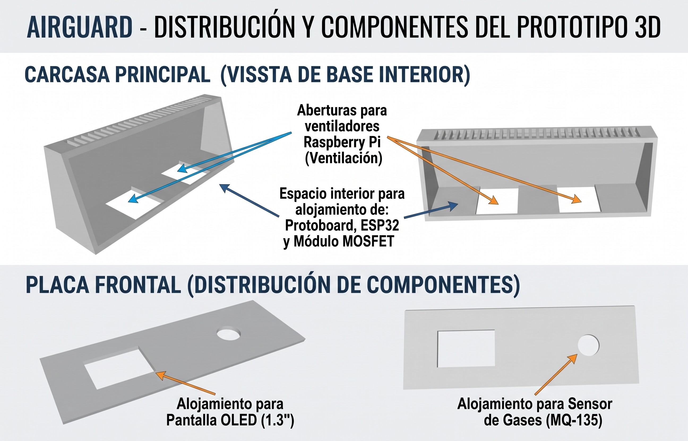

# AIRGUARD - Dispositivo de Monitoreo de Calidad de Aire para Taller Mecánico
**Curso:** Taller de Diseño en Ingeniería (TEI201)

---

## 1. Modelo 3D del Prototipo
Se adjuntan los archivos `.stl` que componen la estructura, carcasa y sujeción del dispositivo:
- `Caja ventilador.stl`
- `Solo placa con sensor.stl`
- `Gancho grande.stl` y `Gancho cuadrado.stl`

### Distribución de Componentes y Espacios Interiores:

**Consideraciones de diseño:**
- **Alojamiento interior:** Espacio dimensionado para albergar de forma segura la Protoboard, la placa microcontroladora ESP32 y el módulo MOSFET de potencia.
- **Ventilación activa:** Ranuras base diseñadas para el flujo de ventiladores tipo Raspberry Pi.
- **Distribución exterior / Interfaz:** Placa frontal con abertura rectangular para pantalla OLED de 1.3" y orificio circular de acople directo para la recámara de sensado del sensor MQ-135.

---

## 2. Código de Control (Arduino)
- **Archivo fuente:** `AIRGUARD_MQ135_OLED.zip` (código para ESP32 Dev Module).
- **Lógica implementada:** 
  - Adquisición de señal analógica mediante pin GPIO 34 (con divisor de tensión resistivo para protección del ADC a 3.3V).
  - Filtrado por promedio móvil (15 muestras) y estimación de concentración en PPM.
  - Visualización en
